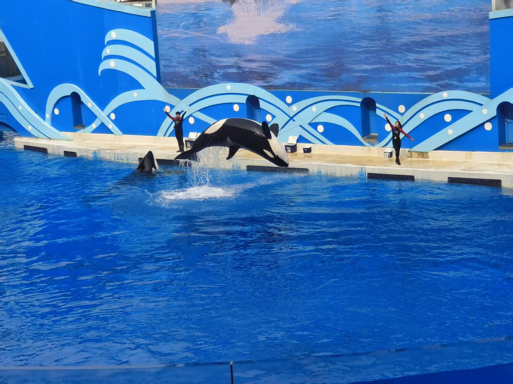
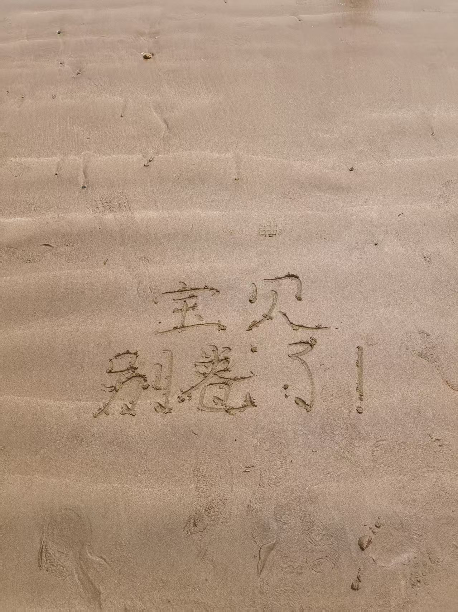

---
hide:
  - navigation
  - toc
---

<section class="home-intro">

 YOUNGINGER · PERSONAL JOURNAL

<h1>认真学习， 也认真生活。</h1>

你好，我是 Younginger。这里记录我探索 AI 的过程， 也收藏一些值得停下脚步的日常。

<a class="button button-primary" href="llm-study/">翻开学习笔记 ↗</a><a class="button button-quiet" href="about/">认识一下我 →</a>

AI / RESEARCH / PHOTOGRAPHY保持好奇，慢慢向前。

生活的切片<a href="photography/">探索相册 ↗</a>

<button type="button" data-prev aria-label="上一张">←</button>01 / 10<button type="button" data-pause aria-label="暂停自动轮播">暂停</button><button type="button" data-next aria-label="下一张">→</button>

THROUGH MY LENS 在算法之外，看看世界。

</section>
<section class="home-section" aria-labelledby="explore-title">

A LITTLE OF EVERYTHING
<h2 id="explore-title">在这里，随意逛逛</h2>
学习与生活，都值得记录。

<a class="journal-card" href="llm-study/">01 / LEARNING⌘<h3>学习笔记</h3>
从 Transformer 到世界模型。把复杂的概念，一点点想明白。
一起探索 AI ↗</a>
<a class="journal-card" href="medical-ai/">02 / RESEARCH✳<h3>科研手记</h3>
计算机视觉与医学图像。记录问题、尝试，以及途中的发现。
走进实验室 ↗</a>
<a class="journal-card card-photo" href="photography/">03 / LIFE◎<h3>生活瞬间</h3>
城市、光影和动物朋友。平凡的日子，也有自己的闪光。
看看我的相册 ↗</a>

</section>
<section class="home-section notebook-section" aria-labelledby="notebook-title">

THE OPEN NOTEBOOK
<h2 id="notebook-title">循着好奇心学习</h2>
<a class="text-link" href="diffusion-study/">从第一篇开始 ↗</a>

<a href="llm-study/">01
<h3>大模型与 Transformer</h3>
架构、预训练与推理

LLM↗</a>
<a href="World_Models/">02
<h3>理解世界模型</h3>
World Models 与 Dreamer

WORLD MODELS↗</a>
<a href="RL/">03
<h3>强化学习的旅程</h3>
从 MDP 到策略优化

RL↗</a>
<a href="diffusion-study/">04
<h3>扩散模型学习</h3>
生成模型与图像探索

DIFFUSION↗</a>

</section>

不急着抵达，先享受探索。
<a href="https://github.com/younginger">在 GitHub 找到我 ↗</a>

