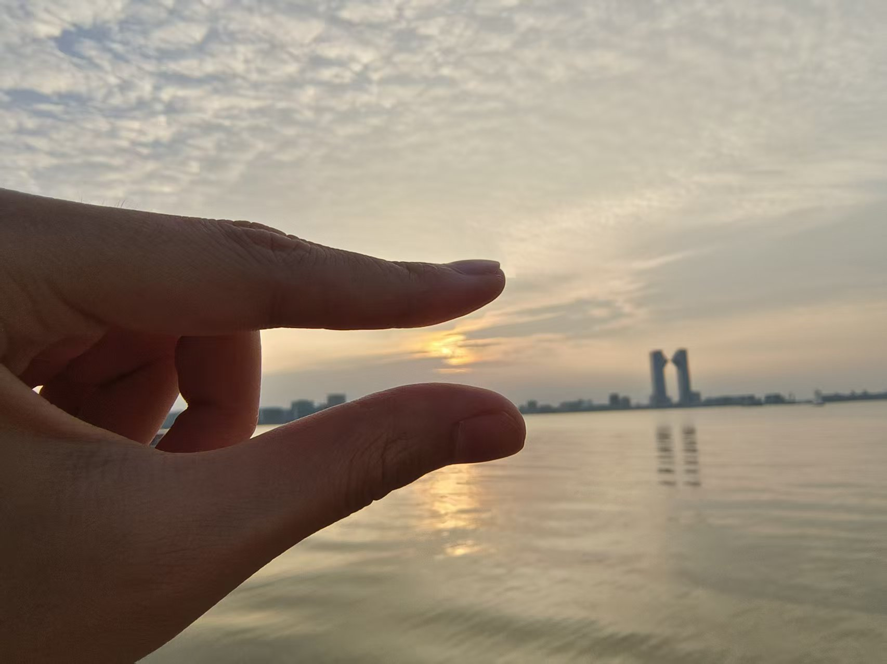
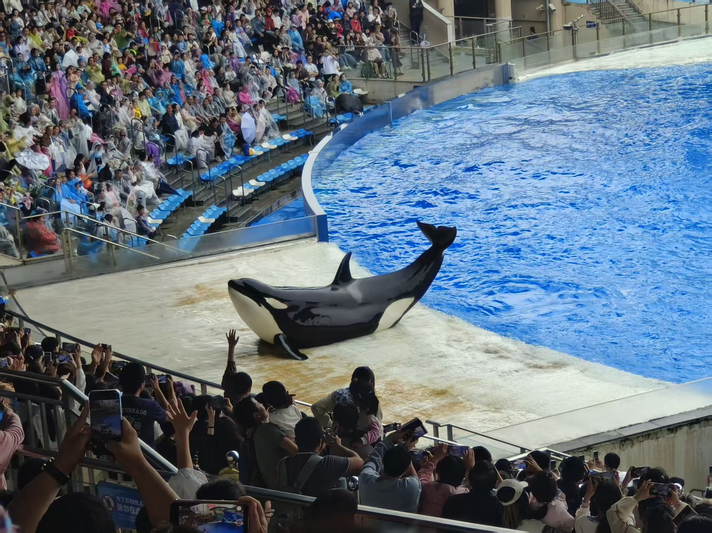
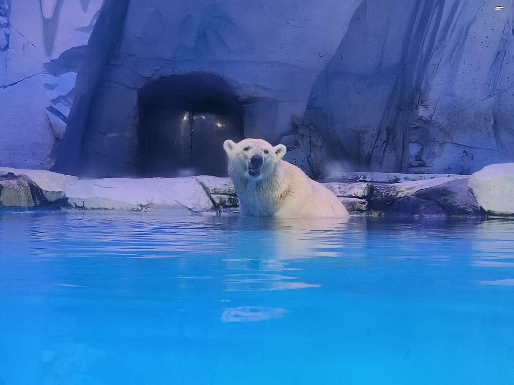
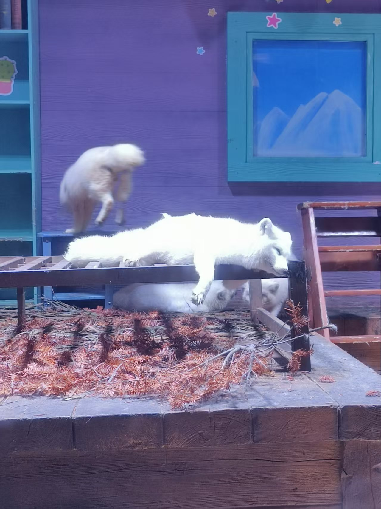
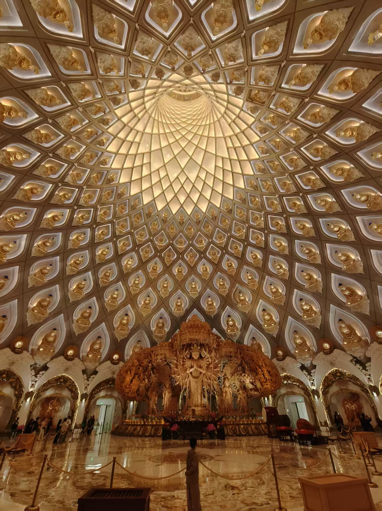
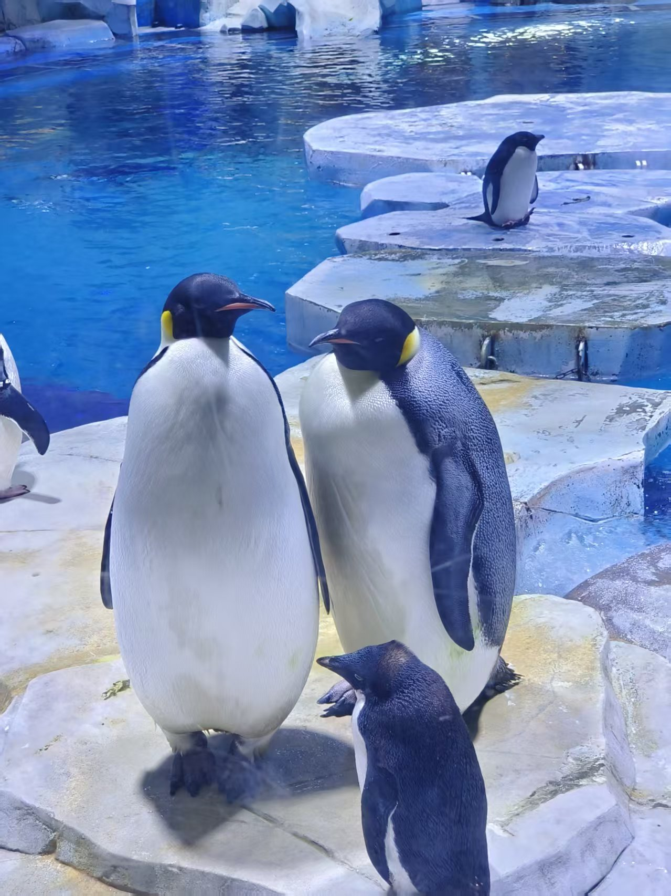

---
hide:
  - toc
---

LIFE, IN FRAMES

<h1>镜头里的世界。</h1>

把日常留在画面里。点击照片，看看那些值得珍藏的细节。

<button type="button" class="filter-button is-active" data-filter="all" aria-pressed="true">全部 10</button><button type="button" class="filter-button" data-filter="banner" aria-pressed="false">精选影像 6</button><button type="button" class="filter-button" data-filter="photo" aria-pressed="false">日常记录 4</button>10 张影像

<a href="../assets/images/banner1.jpg" class="photo-item" data-category="banner" aria-label="查看精选影像 1">精选影像 / 01↗</a>
<a href="../assets/images/banner2.jpg" class="photo-item" data-category="banner" aria-label="查看精选影像 2">精选影像 / 02↗</a>
<a href="../assets/images/banner3.jpg" class="photo-item" data-category="banner" aria-label="查看精选影像 3">精选影像 / 03↗</a>
<a href="../assets/images/banner4.jpg" class="photo-item" data-category="banner" aria-label="查看精选影像 4">精选影像 / 04↗</a>
<a href="../assets/images/banner5.jpg" class="photo-item" data-category="banner" aria-label="查看精选影像 5">精选影像 / 05↗</a>
<a href="../assets/images/banner6.jpg" class="photo-item" data-category="banner" aria-label="查看精选影像 6">精选影像 / 06↗</a>
<a href="../assets/images/photo1.jpg" class="photo-item" data-category="photo" aria-label="查看日常记录 1">日常记录 / 01↗</a>
<a href="../assets/images/photo2.jpg" class="photo-item" data-category="photo" aria-label="查看日常记录 2">日常记录 / 02↗</a>
<a href="../assets/images/photo3.jpg" class="photo-item" data-category="photo" aria-label="查看日常记录 3">日常记录 / 03↗</a>
<a href="../assets/images/photo4.jpg" class="photo-item" data-category="photo" aria-label="查看日常记录 4">日常记录 / 04↗</a>

